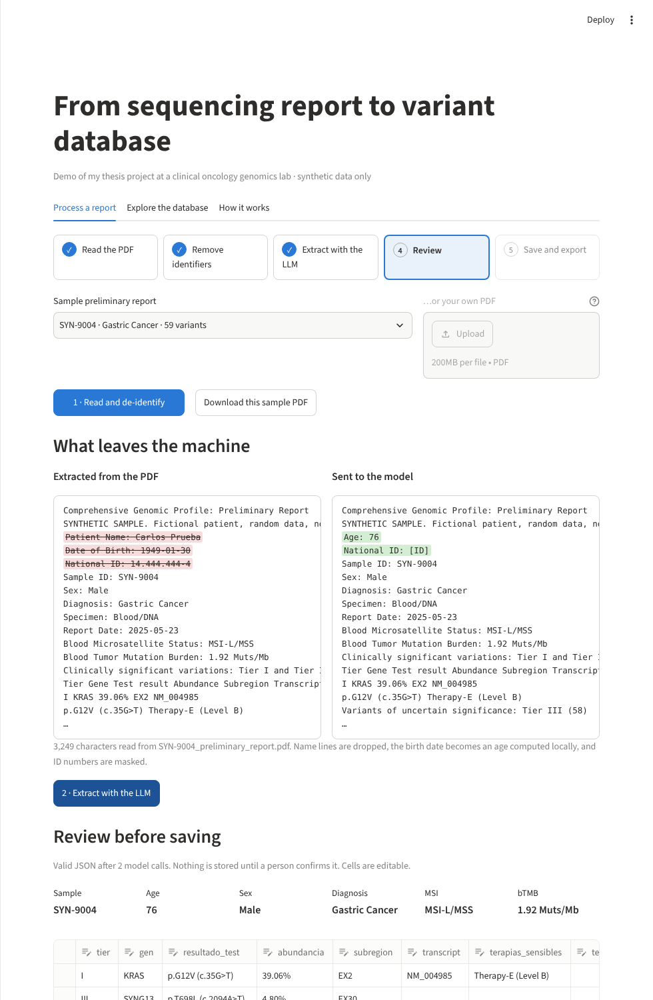
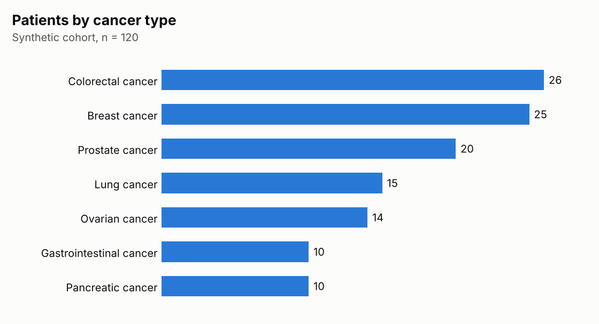
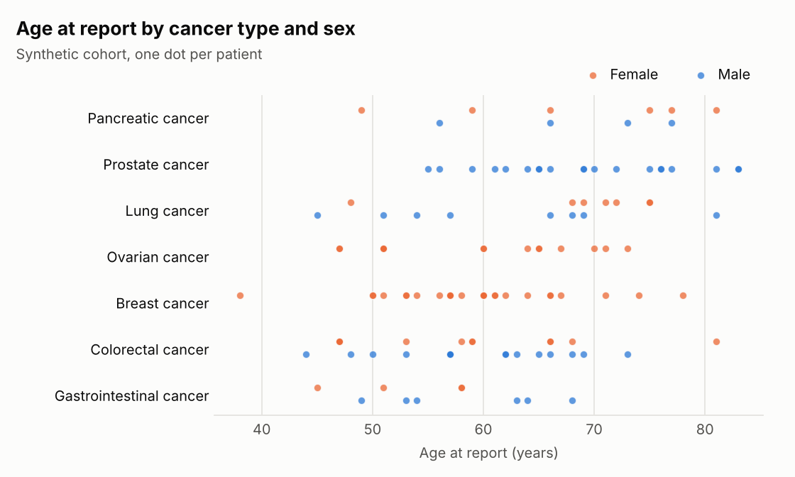
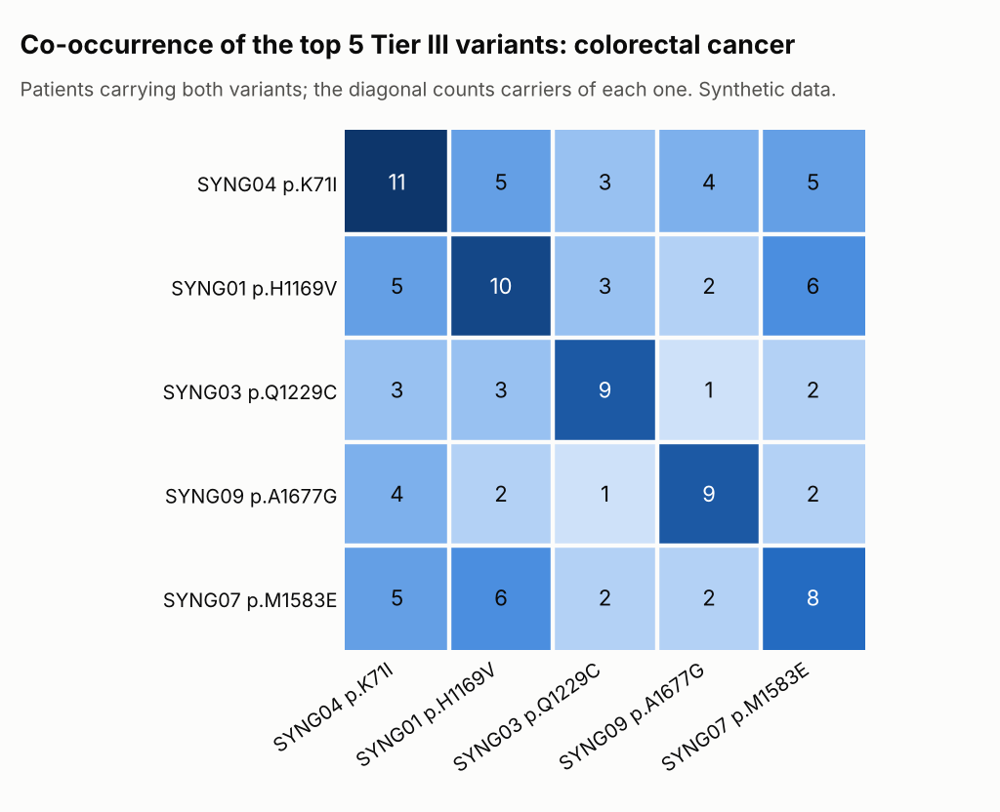

# onco-variant-pipeline

From sequencing reports to a queryable variant database, with an LLM doing the reading.

This is a public, synthetic-data version of my undergraduate thesis project at
Nomad Genetics, a clinical oncology genomics lab in Santiago, Chile (2025).
**It contains no patient data and no real reports.** Every record in
`data/synthetic/` and every PDF in `samples/` is generated by code in this repository.

## The problem

The lab receives a preliminary report for every sequenced sample: 20 to 60
pages, 750+ genes, and a different layout per sequencing platform. Writing the
final report meant copying variants by hand: 1 to 2 hours per report, 3 to 5
reports per week, in a lab of three people. And once a report was sent, its
results were stored nowhere: the lab could not query its own findings.

## What I built

```
PDF report (platform A) ──> text, patient name removed ──> LLM ──┐
                                                                 ├──> standard JSON ──> human check ──┬──> Excel for the final report
JSON export (platform B) ──> deterministic mapping ──────────────┘                                    └──> SQLite ──> analyses
```

| Step | Module | Notes |
| --- | --- | --- |
| Read the PDF | `extract.py` | `pdfplumber`; names and IDs are removed and the birth date is replaced by the age before any text leaves the machine |
| Structure it | `extract.py` | Gemini 2.0 Flash, temperature 0, fixed JSON schema |
| Survive long reports | `extract.py`, `json_repair.py` | A truncated answer triggers a continuation call; if that fails, every complete variant is kept |
| Second platform | `avenio.py` | Already structured, so plain Python rules, no LLM |
| Store | `database.py` | SQLAlchemy + SQLite, two tables, safe to re-run (no duplicates) |
| Analyse | `analysis.py` | Variant frequency by tier and cancer type, demographics, co-occurrence |
| Demo UI | `app.py`, `samples.py` | Streamlit app over the same modules, with fictional PDF reports |

In production a person reviewed each extraction before it was saved, and every
intermediate step was written to a debug folder.

## Results in the lab

- About 30 minutes saved per report, a 25% to 50% reduction depending on report length. The target was 50%: short reports reach it; on long ones the remaining manual step (building the Word report) dominates.
- An estimated 3.25 staff hours freed per week, at zero running cost (free tiers and open-source tools only).
- 153 patients and 3,811 variants loaded from historical reports: the lab's first database of its own results.
- First in-house analyses: most frequent variants of uncertain significance per cancer type, age and sex distributions, co-occurrence of variants.

## Try the app



```bash
pip install -r requirements.txt
streamlit run app.py
```

Pick one of the fictional PDF reports in `samples/`, watch it being read and
de-identified, run the extraction, review the result and save it. The longest
sample (SYN-9004) overflows the model's output on purpose, so you can see the
continuation call at work. The model call is simulated unless you enter your
own Gemini key in the sidebar; everything else runs for real.

## Run the pipeline from the terminal

```bash
python scripts/run_demo.py     # generate 120 synthetic reports, load them, analyse
python -m pytest               # 12 tests, no network or API key needed
```

The demo does not call the LLM: it starts from synthetic JSON reports. To run
the extraction on your own PDF, set `GOOGLE_API_KEY` (see `.env.example`) and use:

```python
from oncopipe.extract import extract_text_from_pdf, deidentify, extract_report, gemini_generate

text = deidentify(extract_text_from_pdf("report.pdf"))
data = extract_report(text, gemini_generate())
```

## Output on synthetic data





These figures show what the analyses look like. The numbers are random and
carry no clinical meaning.

## Design decisions

- **LLM over OCR or rule-based parsing.** Layouts differ per provider and tables break across pages; rule-based libraries need fixed structures, and OCR services are priced for a much larger scale.
- **Privacy first.** Direct identifiers are removed before the API call, the database is local, and patients are identified by sample code only.
- **One standard JSON.** Both platforms converge on the same schema, so the database and the report generator have a single input format.
- **SQLite.** Local, free and enough for the lab's volume; the JSON files remain as a backup from which the database can be rebuilt.

## Limitations

- Every extraction was reviewed by a person before it was saved. This repository does not include an accuracy benchmark.
- De-identification is pattern-based and covers the report layouts the lab received; a new layout needs its patterns checked.
- Tier III variants are capped per report (60 by default; the continuation call roughly doubles that) to keep responses within the model's output limit.

## Stack

Python · pdfplumber · Gemini API · SQLAlchemy · SQLite · pandas · matplotlib · Streamlit · Altair · pytest
